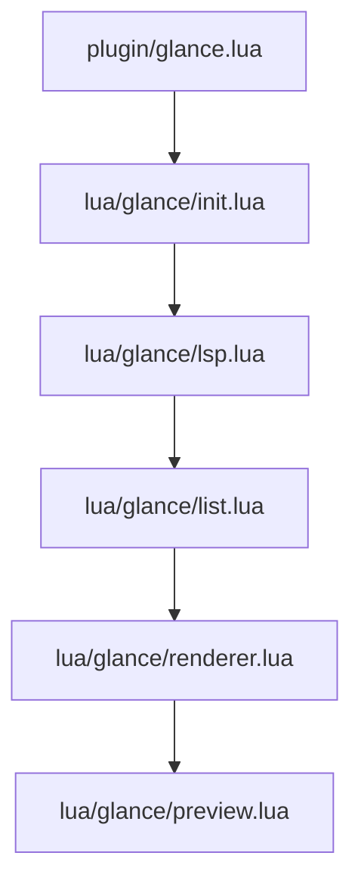

# DNLHC/glance.nvim

> Neovim plugin that opens an editable preview of LSP definitions and references, like VSCode.

## The problem
Jumping to a definition or a reference makes you leave the current file and lose context.

## What it actually does
Displays, in a floating or embedded window, the definitions, types, references and implementations provided by the LSP. You can edit there, open in a split or tab, or send everything to the quickfix list. Supports custom LSP methods and hooks.

## How it is wired
Diagram based on the code diagram.


## Trying it
```bash
# lazy.nvim : { 'dnlhc/glance.nvim', cmd = 'Glance' }
# puis dans Neovim :
:Glance definitions
:Glance references
```

## Cost and gotchas
Free. Requires Neovim 0.9 or later and a configured LSP client; the context option requires Neovim 0.10.

## What it is not
Not an LSP server: it displays what your LSP provides. No useful configuration without an active LSP.

## Alternatives
- nvim-telescope/telescope.nvim
- glepnir/lspsaga.nvim
- rmagatti/goto-preview

## For you
Worth watching if you code Python in Neovim: it makes LSP navigation more comfortable, with no link to AI itself.
