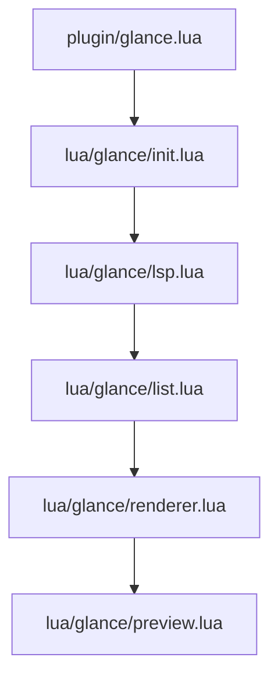

# DNLHC/glance.nvim

> Plugin Neovim qui ouvre un aperçu éditable des définitions et références LSP, comme VSCode.

## Le problème
Aller à une définition ou une référence fait quitter le fichier courant et perdre le contexte.

## Ce que ça fait vraiment
Affiche dans une fenêtre flottante ou intégrée les définitions, types, références et implémentations fournis par le LSP. On peut y éditer, ouvrir en split ou onglet, ou envoyer tout au quickfix. Prend en charge des méthodes LSP personnalisées et des hooks.

## Comment c'est branché
Schéma d'après le diagramme du code.


## Essayer
```bash
# lazy.nvim : { 'dnlhc/glance.nvim', cmd = 'Glance' }
# puis dans Neovim :
:Glance definitions
:Glance references
```

## Coût et pièges
Gratuit. Demande Neovim 0.9 ou plus et un client LSP configuré ; l'option de contexte requiert Neovim 0.10.

## Ce que ce n'est pas
Pas un serveur LSP : il affiche ce que ton LSP fournit. Pas de configuration utile sans LSP actif.

## Alternatives
- nvim-telescope/telescope.nvim
- glepnir/lspsaga.nvim
- rmagatti/goto-preview

## Pour toi
À surveiller si tu codes Python dans Neovim : il rend la navigation LSP plus confortable, sans lien avec l'IA elle-même.

