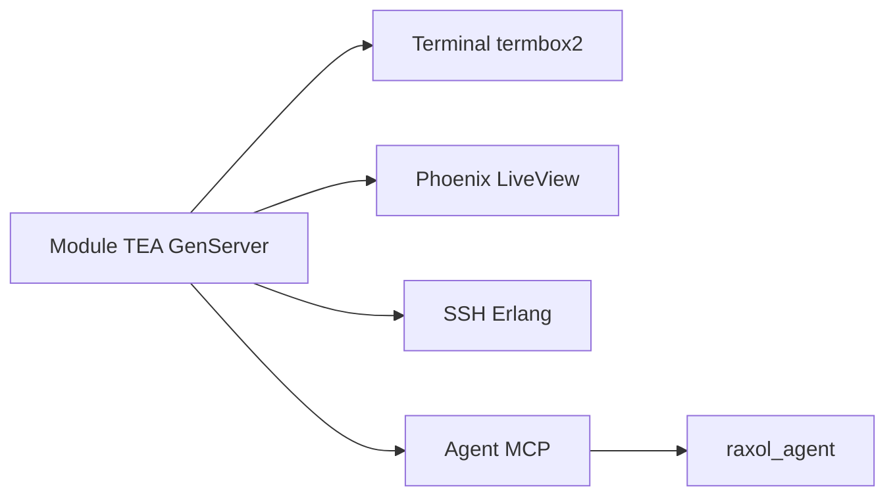

# DROOdotFOO/raxol

> Elixir framework that renders a single app to terminal, browser, SSH and agents via MCP.

## The problem
Writing an interface for terminal, web and agents forces you to maintain as much code as there are surfaces.

## What it actually does
An application is a TEA module (`init`, `update`, `view`) running as a GenServer. Raxol renders it on a terminal (termbox2 NIF), Phoenix LiveView, SSH and MCP tools automatically exposed by each component. It also ships a terminal coding agent (`mix raxol.code`) with ALLOW/ASK/DENY authorization, and payment, gateway and ACP protocol packages.

## How it is wired


## Trying it
```bash
mix raxol.new my_app
git clone https://github.com/DROOdotFOO/raxol.git
cd raxol && mix deps.get
mix raxol.playground
```

## Cost and gotchas
Elixir and a C compiler for the termbox2 NIF. The agent requires a model provider key. The payment packages deal with wallets and tokens: be careful.

## What it is not
It is not just a terminal framework: it mixes agents, payments and the $RAXOL token. Some packages are flagged pre-alpha.

## Alternatives
- Bubble Tea, Ratatui, Textual: terminal rendering engines cited, without the agent part.

## For you
Watch: the idea of an interface projected as an MCP agent surface is interesting, but the scope is very wide and carried by a single person.
