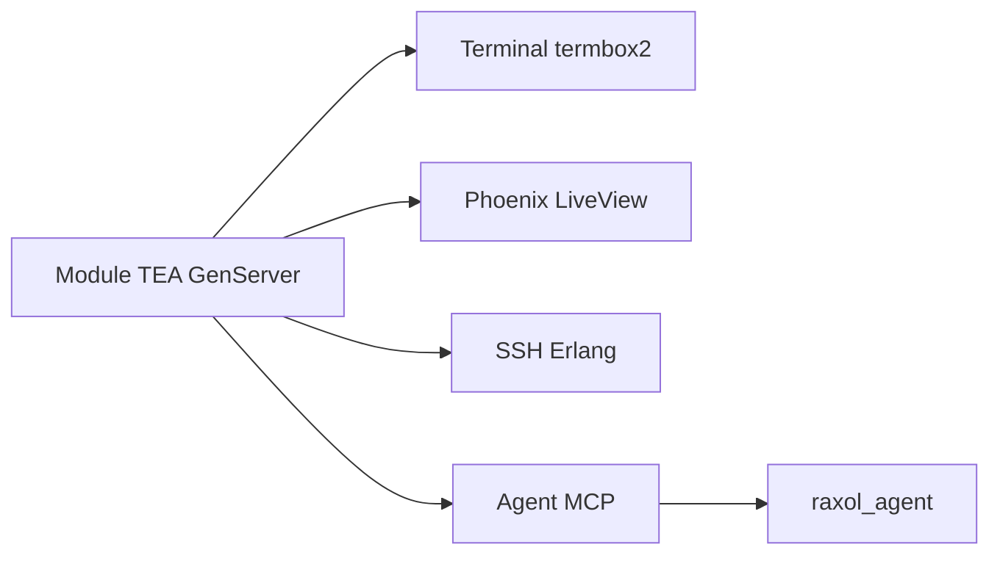

# DROOdotFOO/raxol

> Framework Elixir qui rend une même appli vers terminal, navigateur, SSH et agents via MCP.

## Le problème
Écrire une interface pour terminal, web et agents oblige à maintenir autant de code que de surfaces.

## Ce que ça fait vraiment
Une application est un module TEA (`init`, `update`, `view`) qui tourne en GenServer. Raxol la rend sur un terminal (NIF termbox2), Phoenix LiveView, SSH et des outils MCP exposés automatiquement par chaque composant. Il embarque aussi un agent de code en terminal (`mix raxol.code`) avec autorisation ALLOW/ASK/DENY, et des paquets de paiement, de passerelle et de protocole ACP.

## Comment c'est branché


## Essayer
```bash
mix raxol.new my_app
git clone https://github.com/DROOdotFOO/raxol.git
cd raxol && mix deps.get
mix raxol.playground
```

## Coût et pièges
Elixir et un compilateur C pour le NIF termbox2. L'agent demande une clé de fournisseur de modèle. Les paquets de paiement touchent à des portefeuilles et des jetons : prudence.

## Ce que ce n'est pas
Ce n'est pas seulement un framework de terminal : il mêle agents, paiements et jeton $RAXOL. Certains paquets sont signalés pré-alpha.

## Alternatives
- Bubble Tea, Ratatui, Textual : moteurs de rendu de terminal cités, sans la partie agent.

## Pour toi
Surveiller : l'idée d'une interface projetée en surface agent MCP est intéressante, mais le périmètre est très large et porté par une seule personne.

