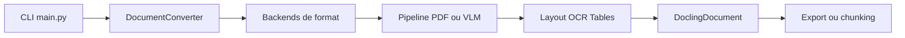

# DS4SD/docling

> Converts PDF, Office, images and audio into a structured document, to feed RAG or AI pipelines.

## The problem
PDFs and office documents lose their layout, tables and reading order when passed to a language model.

## What it actually does
Docling reads many formats (PDF, DOCX, PPTX, XLSX, HTML, images, audio, video, emails, EPUB…) and produces a `DoclingDocument` that can be exported losslessly to Markdown, HTML or JSON. PDFs go through layout analysis, reading order, tables, formulas and OCR; vision models (GraniteDocling) are possible. Runs locally, with a CLI, an MCP server, docling-serve and integrations with LangChain, LlamaIndex, Crew AI, Haystack.

## How it is wired


## Trying it
```bash
pip install docling
docling https://arxiv.org/pdf/2206.01062
docling --pipeline vlm --vlm-model granite_docling https://arxiv.org/pdf/2206.01062
```
```python
from docling.document_converter import DocumentConverter
converter = DocumentConverter()
result = converter.convert("https://arxiv.org/pdf/2408.09869")
print(result.document.export_to_markdown())
```

## Cost and gotchas
Python 3.10 minimum. GPU needs and model download sizes are not detailed in the README. Anomaly: same README as `docling-project/docling`.

## What it is not
Not an LLM: it prepares documents. The "coming soon" features (metadata, chemistry) are not delivered.

## Alternatives
No alternative named in the README.

## For you
Adopt: the reference document-ingestion building block for a RAG pipeline, under MIT and backed by a foundation.
