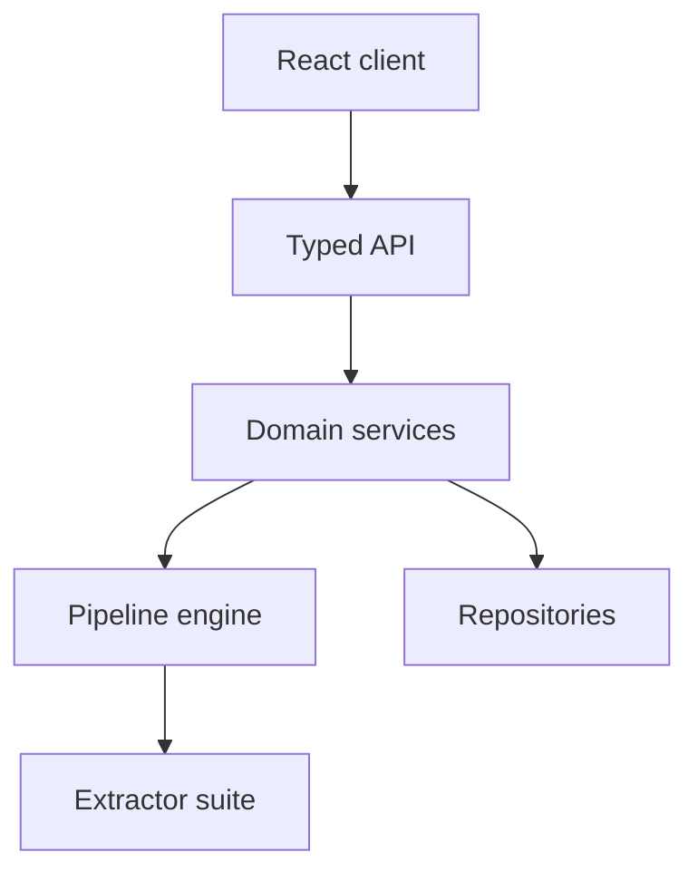

# DaKheera47/job-ops

> Self-hosted application that searches for job offers, tailors your CV and tracks your applications.

## The problem
Job hunting scatters offers, CV versions and recruiter replies across several sites and spreadsheets.

## What it actually does
A pipeline searches for offers on more than ten sites, scores them from 0 to 100 against your profile, rewrites the CV for each position and exports a PDF. The tracking reads your Gmail inbox to sort interviews and rejections. It does not send applications automatically. The application is a TypeScript monorepo: React client, Node API, services, repositories and extractors, including one in Python (jobspy).

## How it is wired


## Trying it
```bash
git clone https://github.com/DaKheera47/job-ops.git
cd job-ops
docker compose up -d
```

## Cost and gotchas
Free when self-hosted; you need an LLM provider's key, billed by them. Cloud offer at 20 or 30 pounds per month. Anonymous Umami statistics are sent; to turn them off, block the domain in the firewall. License not identified by GitHub.

## What it is not
It is not an automatic application tool. The usage figures in the README (800 users) cannot be verified. The site extractors can break when a site changes.

## Alternatives
No alternative named in the README.

## For you
Keep an eye on it: a good example of a complete LLM application (pipeline, scoring, extractors) to read, useful for job hunting if the license suits you.
