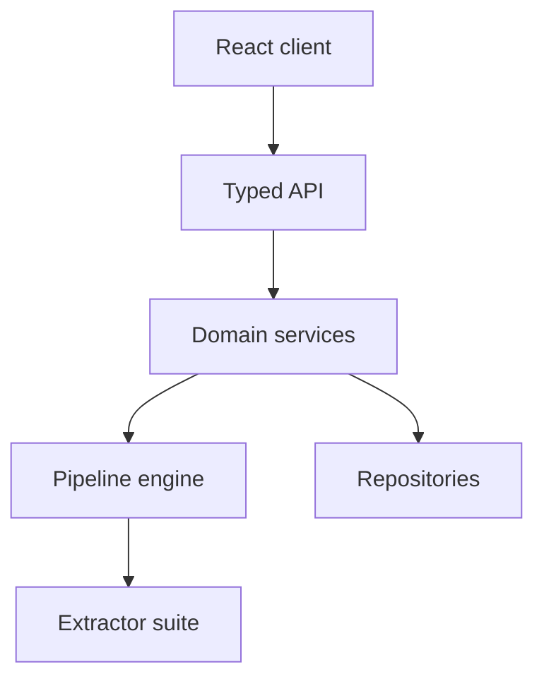

# DaKheera47/job-ops

> Application auto-hébergée qui cherche des offres, adapte ton CV et suit tes candidatures.

## Le problème
La recherche d'emploi disperse offres, versions de CV et réponses de recruteurs entre plusieurs sites et tableurs.

## Ce que ça fait vraiment
Un pipeline cherche des offres sur plus de dix sites, les note de 0 à 100 par rapport à ton profil, réécrit le CV pour chaque poste et exporte un PDF. Le suivi lit ta boîte Gmail pour classer entretiens et refus. Il n'envoie pas de candidatures automatiques. L'application est un monorepo TypeScript : client React, API Node, services, dépôts et extracteurs, dont un en Python (jobspy).

## Comment c'est branché


## Essayer
```bash
git clone https://github.com/DaKheera47/job-ops.git
cd job-ops
docker compose up -d
```

## Coût et pièges
Gratuit en auto-hébergement ; il faut la clé d'un fournisseur de LLM, facturée chez lui. Offre cloud à 20 ou 30 livres par mois. Des statistiques anonymes Umami sont envoyées ; pour les couper, bloquer le domaine dans le pare-feu. Licence non identifiée par GitHub.

## Ce que ce n'est pas
Ce n'est pas un outil de candidature automatique. Les chiffres d'usage du README (800 utilisateurs) ne sont pas vérifiables. Les extracteurs de sites peuvent casser quand un site change.

## Alternatives
Aucune alternative nommée dans le README.

## Pour toi
Surveiller : bon exemple d'application LLM complète (pipeline, scoring, extracteurs) à lire, utile en recherche d'emploi si la licence te convient.

