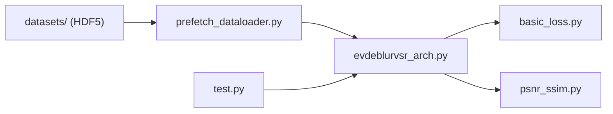

# DachunKai/Ev-DeblurVSR

> Official PyTorch implementation of event-guided blurry video super-resolution (AAAI 2025), for vision researchers.

## The problem
Blurry low-resolution videos lose details that event cameras captured: classic methods do not exploit them.

## What it actually does
Research code based on BasicSR that takes video and events (voxels in an HDF5 file) and produces a sharp ×4 video. Pre-trained models are provided for GoPro, BSD and NCER, with multi-GPU test scripts and measurement of parameters and runtime. Only inference/testing is documented, not training.

## How it is wired


## Trying it
```bash
conda create -y -n ev-deblurvsr python=3.7
conda activate ev-deblurvsr
git clone https://github.com/DachunKai/Ev-DeblurVSR
cd Ev-DeblurVSR && pip install -r requirements.txt && python setup.py develop
./scripts/dist_test.sh [num_gpus] options/test/EvDeblurVSR/test_EvDeblurVSR_GoPro_x4.yml
```

## Cost and gotchas
Old stack (Python 3.7, CUDA 11.1.1, torch 1.10.2). Weights and test sets must be downloaded from Baidu Cloud or Google Drive. You need event data, which is rare outside these datasets.

## What it is not
Not an application nor an API: research paper code. Does not process videos without event data.

## Alternatives
The README cites EvTexture, by the same author, whose Docker image it reuses.

## For you
Ignore: a research niche that depends on event cameras, with a dated software stack.
