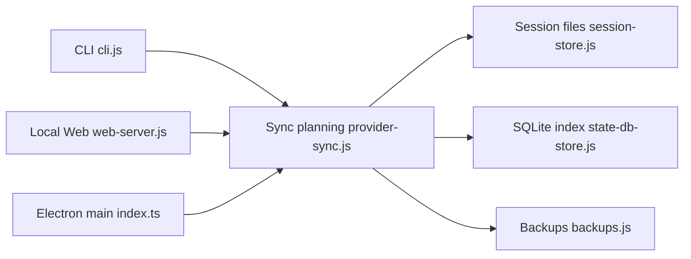

# Dailin521/codex-provider-sync

> Aligns the provider recorded in Codex sessions after a provider switch, for Codex users.

## The problem
After switching providers (for example with CCSwitch), old Codex sessions still show the previous provider and become hard to resume.

## What it actually does
It updates the provider name in the first lines of the session files and in Codex's SQLite index, without touching the conversation content or `auth.json`. Automatic backup before writing (2 kept), restore, preview, watch mode. Three entry points: Windows application, local web interface, CLI.

## How it is wired


## Trying it
```bash
npm install -g @dailin521/codex-provider-sync
codex-provider status
codex-provider sync
```

## Cost and gotchas
Free. The Windows application is not signed; no macOS/Linux package. It does not guarantee that the session can be resumed (encrypted content, model compatibility).

## What it is not
Not an authentication switching tool nor a conversation migration tool between accounts. README in Chinese.

## Alternatives
- CCSwitch: provider switching tool mentioned in the README.

## For you
Ignore unless you use Codex with several providers; it is a metadata fix, with no data/MLOps relevance.
