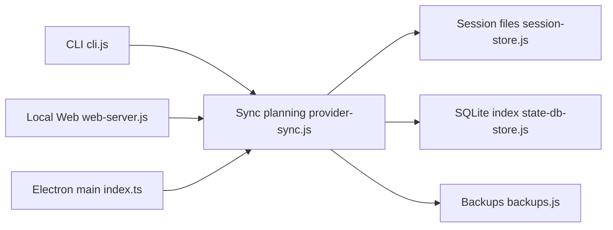

# Dailin521/codex-provider-sync

> Aligne le fournisseur enregistré dans les sessions Codex après un changement de fournisseur, pour utilisateurs de Codex.

## Le problème
Après avoir changé de fournisseur (par exemple avec CCSwitch), les anciennes sessions Codex indiquent encore l'ancien fournisseur et deviennent difficiles à reprendre.

## Ce que ça fait vraiment
Il met à jour le nom du fournisseur dans les premières lignes des fichiers de session et dans l'index SQLite de Codex, sans toucher au contenu des conversations ni à `auth.json`. Sauvegarde automatique avant écriture (2 conservées), restauration, prévisualisation, mode surveillance. Trois entrées : application Windows, interface web locale, CLI.

## Comment c'est branché


## Essayer
```bash
npm install -g @dailin521/codex-provider-sync
codex-provider status
codex-provider sync
```

## Coût et pièges
Gratuit. L'application Windows n'est pas signée ; pas de paquet macOS/Linux. Il ne garantit pas que la session puisse reprendre (contenu chiffré, compatibilité de modèle).

## Ce que ce n'est pas
Pas un outil de bascule d'authentification ni de migration de conversations entre comptes. README en chinois.

## Alternatives
- CCSwitch : outil de bascule de fournisseur cité dans le README.

## Pour toi
À ignorer sauf si tu utilises Codex avec plusieurs fournisseurs ; c'est un correctif de métadonnées, sans portée data/MLOps.

