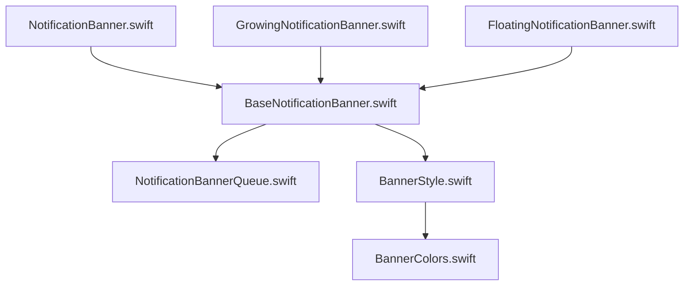

# Daltron/NotificationBanner

> Swift library for displaying notification banners in an iOS application.

## The problem
Displaying alerts that slide down from the top of the screen, with a queue and styles, takes a lot of UIKit code.

## What it actually does
Standard, growing, floating or status-bar banners, with side views or a custom view, overridable colors, haptic feedback, gestures (tap, swipe) and a queue that can show several at once. All inherit from `BaseNotificationBanner.swift`. iOS 12 and Xcode 10 minimum.

## How it is wired


## Trying it
```bash
# Swift Package Manager : https://github.com/Daltron/NotificationBanner
pod 'NotificationBannerSwift', '2.5.0'
```
```swift
let banner = NotificationBanner(title: title, subtitle: subtitle, style: .success)
banner.show()
```

## Cost and gotchas
Free. Installation methods other than SwiftPM are deprecated. Last push in July 2024.

## What it is not
Not a push notification system: these are in-app banners. iOS only.

## Alternatives
No alternative named in the README.

## For you
Ignore: an iOS interface component unrelated to data or AI.
