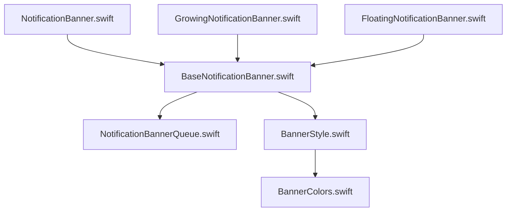

# Daltron/NotificationBanner

> Bibliothèque Swift pour afficher des bannières de notification dans une application iOS.

## Le problème
Afficher des alertes qui descendent en haut de l'écran, avec file d'attente et styles, demande beaucoup de code UIKit.

## Ce que ça fait vraiment
Bannières standard, grandissantes, flottantes ou en barre d'état, avec vues latérales ou vue personnalisée, couleurs surchargeables, retour haptique, gestes (tap, balayage) et une file d'attente qui peut en afficher plusieurs à la fois. Toutes héritent de `BaseNotificationBanner.swift`. iOS 12 et Xcode 10 minimum.

## Comment c'est branché


## Essayer
```bash
# Swift Package Manager : https://github.com/Daltron/NotificationBanner
pod 'NotificationBannerSwift', '2.5.0'
```
```swift
let banner = NotificationBanner(title: title, subtitle: subtitle, style: .success)
banner.show()
```

## Coût et pièges
Gratuit. Les autres méthodes d'installation que SwiftPM sont dépréciées. Dernier push en juillet 2024.

## Ce que ce n'est pas
Pas un système de notifications push : ce sont des bannières internes à l'application. iOS uniquement.

## Alternatives
Aucune alternative nommée dans le README.

## Pour toi
Ignorer : composant d'interface iOS sans rapport avec la data ou l'IA.

