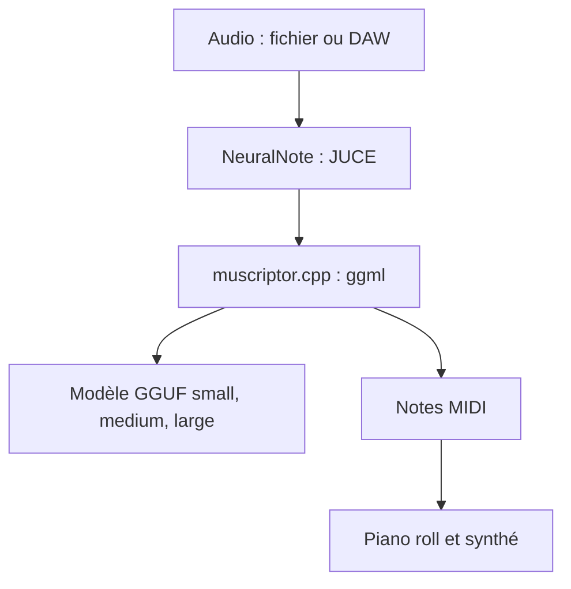

# DamRsn/NeuralNote

> Audio plugin (VST3, AU, application) that transcribes a recording into MIDI, locally, for musicians and producers.

## The problem
Transcribing a piece into MIDI notes by hand is slow; online tools send your audio to a server.

## What it actually does
v2 replaces Basic Pitch with MuScriptor (a transformer from 103 M to 1.4 B parameters), which transcribes several instruments. A built-in synth lets you listen to each instrument. Everything runs locally, on GPU (Metal, Vulkan) or CPU. The network is used to download models and check for updates.

## How it is wired


## Trying it
```bash
git clone --recurse-submodules https://github.com/DamRsn/NeuralNote
cd NeuralNote
cmake -B build -DCMAKE_BUILD_TYPE=Release
cmake --build build --config Release
```

## Cost and gotchas
Models of 210 MB, 620 MB or 2.7 GB to download; GPU recommended for medium and large. Model weights under CC BY-NC 4.0, so non-commercial use only. Windows installer unsigned. No Linux binary.

## What it is not
Not a cloud service. The code is Apache-2.0, but the model weights are not.

## Alternatives
Spotify's Basic Pitch (version 1 of the plugin); muscriptor.cpp, the reusable engine.

## For you
Worth watching: a clean example of embedded ggml inference, but the non-commercial weights limit any professional use.
