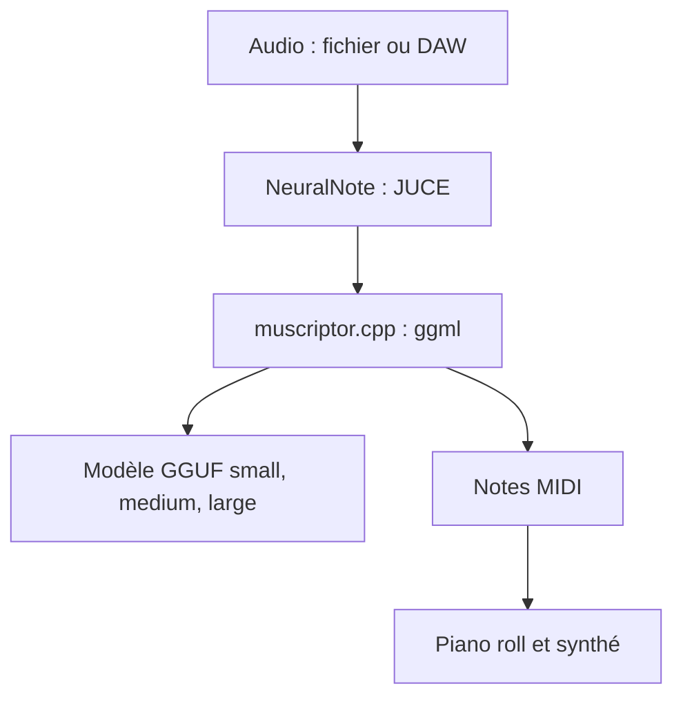

# DamRsn/NeuralNote

> Plugin audio (VST3, AU, application) qui transcrit un enregistrement en MIDI, localement, pour musiciens et producteurs.

## Le problème
Transcrire un morceau en notes MIDI à la main est long ; les outils en ligne envoient votre audio sur un serveur.

## Ce que ça fait vraiment
La v2 remplace Basic Pitch par MuScriptor (transformeur de 103 M à 1,4 Md de paramètres), qui transcrit plusieurs instruments. Un synthé intégré permet d'écouter chaque instrument. Tout tourne en local, sur GPU (Metal, Vulkan) ou CPU. Le réseau sert à télécharger les modèles et vérifier les mises à jour.

## Comment c'est branché


## Essayer
```bash
git clone --recurse-submodules https://github.com/DamRsn/NeuralNote
cd NeuralNote
cmake -B build -DCMAKE_BUILD_TYPE=Release
cmake --build build --config Release
```

## Coût et pièges
Modèles de 210 Mo, 620 Mo ou 2,7 Go à télécharger ; GPU recommandé pour medium et large. Poids du modèle sous CC BY-NC 4.0, donc usage non commercial. Installateur Windows non signé. Pas de binaire Linux.

## Ce que ce n'est pas
Pas un service cloud. Le code est Apache-2.0, mais les poids du modèle ne le sont pas.

## Alternatives
Basic Pitch de Spotify (version 1 du plugin) ; muscriptor.cpp, le moteur réutilisable.

## Pour toi
À surveiller : exemple propre d'inférence ggml embarquée, mais les poids non commerciaux limitent tout usage professionnel.

