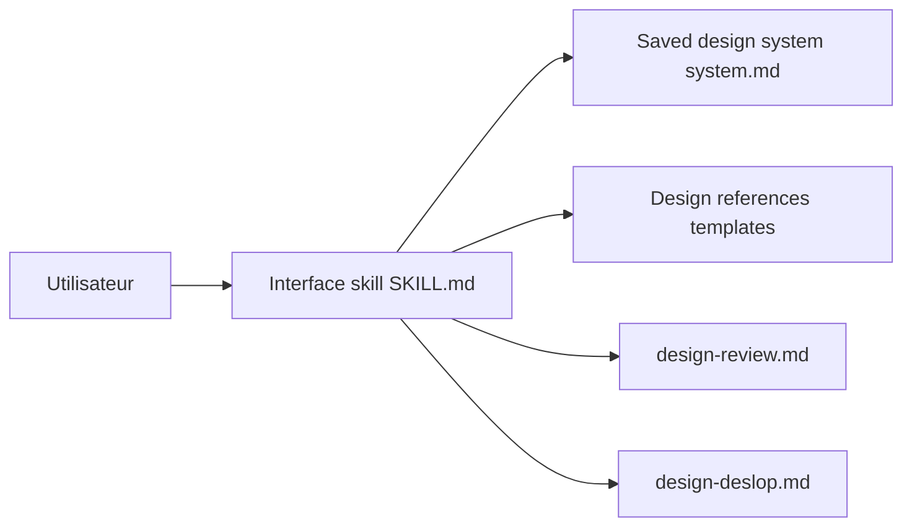

# Dammyjay93/interface-design

> Agent skill that remembers an interface's design decisions (spacing, depth) across sessions.

## The problem
In every session the agent re-decides button heights, spacing and colors; the interface drifts into inconsistency.

## What it actually does
A SKILL.md applies design principles to dashboards and admin tools. Choices are saved in `.interface-design/system.md` and then reloaded. Two commands: `design-review` (strict review) and `design-deslop` (cleanup of generated-UI tics). Optional visual boards if an image tool is available. Not for marketing sites.

## How it is wired


## Trying it
```bash
npx skills add https://github.com/dammyjay93/interface-design --skill interface-design --agent claude-code -g
```
Then `/interface-design`.

## Cost and gotchas
Free. The README reminds you that skills run with the agent's permissions: read it before use. Former name: claude-design-skill; rename `.ds-engineer/` if needed.

## What it is not
Not a component library nor a rendering engine. Last push in June 2026: less frequent maintenance.

## Alternatives
No alternative named in the README.

## For you
Worth watching if you build internal dashboards: useful for visual consistency, incidental for modeling.
