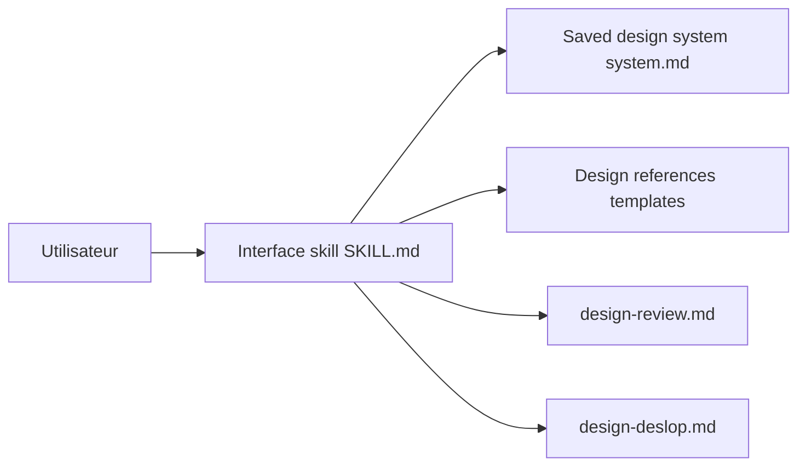

# Dammyjay93/interface-design

> Skill d'agent qui mémorise les décisions de design d'une interface (espacements, profondeur) entre les sessions.

## Le problème
À chaque session, l'agent redécide hauteurs de boutons, espacements, couleurs ; l'interface dérive vers l'incohérence.

## Ce que ça fait vraiment
Un SKILL.md applique des principes de design aux tableaux de bord et outils d'admin. Les choix sont enregistrés dans `.interface-design/system.md` puis rechargés. Deux commandes : `design-review` (revue stricte) et `design-deslop` (nettoyage des tics d'UI générée). Option de planches visuelles si un outil d'image est disponible. Pas pour les sites marketing.

## Comment c'est branché


## Essayer
```bash
npx skills add https://github.com/dammyjay93/interface-design --skill interface-design --agent claude-code -g
```
Puis `/interface-design`.

## Coût et pièges
Gratuit. Le README rappelle que les skills tournent avec les droits de l'agent : relis-le avant usage. Ancien nom : claude-design-skill ; renomme `.ds-engineer/` si nécessaire.

## Ce que ce n'est pas
Pas une librairie de composants ni un moteur de rendu. Dernier push en juin 2026 : maintenance moins fréquente.

## Alternatives
Aucune alternative nommée dans le README.

## Pour toi
À surveiller si tu construis des tableaux de bord internes : utile pour la cohérence visuelle, anecdotique pour la modélisation.

