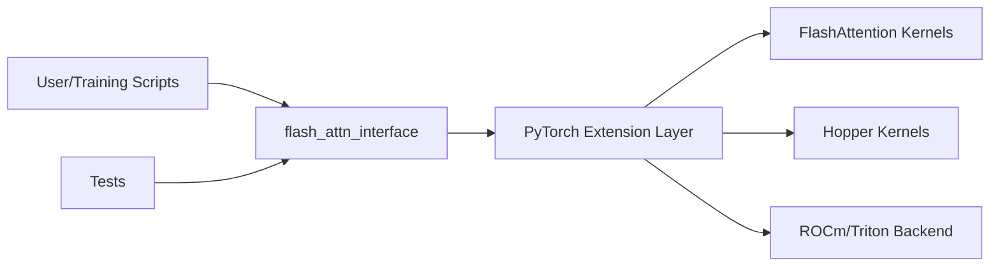

# Dao-AILab/flash-attention

> Exact-attention GPU kernels (FlashAttention 2, 3 beta, 4) for PyTorch, aimed at those who train or serve transformers.

## The problem
Standard attention uses memory that is quadratic in sequence length and quickly saturates the GPU.

## What it actually does
Provides CUDA kernels (and ROCm/Triton for AMD) for attention with forward and backward passes, causal mask, sliding window, ALiBi, MQA/GQA, softcapping and paged KV cache. The README claims linear memory and a 10x saving at a 2K sequence length. FA3 targets Hopper (H100), FA4 (CuTeDSL) targets Hopper and Blackwell. The repository also contains a GPT model and training scripts.

## How it is wired


## Trying it
```bash
pip install flash-attn --no-build-isolation
MAX_JOBS=4 pip install flash-attn --no-build-isolation
pip install flash-attn-4
pytest -q -s tests/test_flash_attn.py
```

## Cost and gotchas
NVIDIA/AMD GPU required, Linux preferred. Without `ninja`, compilation can take 2 h; with less than 96 GB of RAM, limit `MAX_JOBS`. FA3 requires H100/H800 and CUDA >= 12.3.

## What it is not
Not a complete training framework, nor a CPU solution. `flash_attn_with_kvcache` does not support the backward pass. FA3 is announced as beta.

## Alternatives
- Phil Tillet's (OpenAI) Triton implementation: more readable for experimenting.
- Hugging Face `kernels` library: precompiled FA2/FA3 kernels.

## For you
Adopt if you train or serve LLMs on GPU: it is the reference building block, the real constraints are compilation and the CUDA version.
