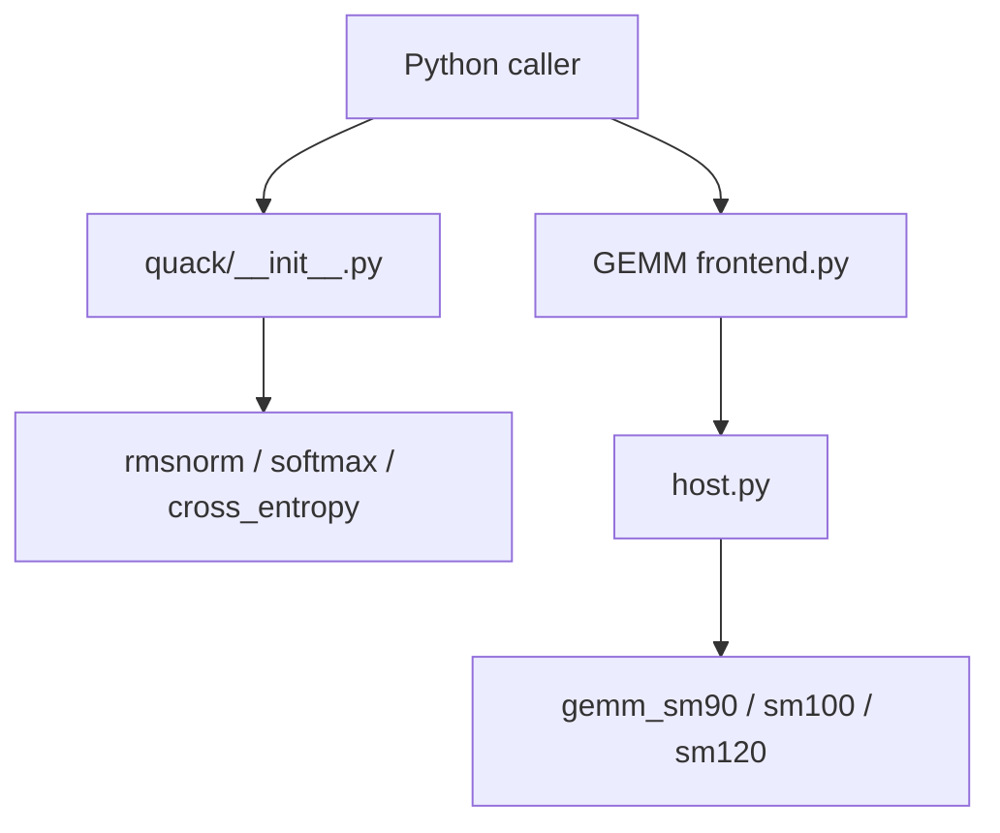

# Dao-AILab/quack

> GPU kernels in CuTe-DSL (normalisations, softmax, cross entropy, GEMM) callable from Python, for those optimising training.

## The problem
Memory-bound operations and GEMMs with epilogue require low-level CUDA to approach the hardware's peak speed.

## What it actually does
- RMSNorm, Softmax, Cross entropy, LayerNorm: forward and backward passes.
- GEMM with epilogue for Hopper, Blackwell and Blackwell GeForce.
- The code also describes a compiled-kernel cache, block-quantised operands, a Hadamard transform and an all-gather GEMM.
- Optional JAX bindings (softmax).

## How it is wired


## Trying it
```bash
pip install quack-kernels
pip install 'quack-kernels[cu13]' --extra-index-url https://download.pytorch.org/whl/cu132
```
```python
from quack import rmsnorm, softmax, cross_entropy
```

## Cost and gotchas
H100, B200/B300 or RTX 50 GPU, CUDA 12.9+, Python 3.12. For CUDA 13.x, do not use uv (installation-order problem, NVIDIA/cutlass#3259).

## What it is not
Neither a training framework nor kernels for older GPUs. Documentation is thin: a blog post and a JAX example.

## Alternatives
None named in the README.

## For you
Worth watching: useful if you have Hopper/Blackwell GPUs and write kernels; otherwise of no immediate interest.
