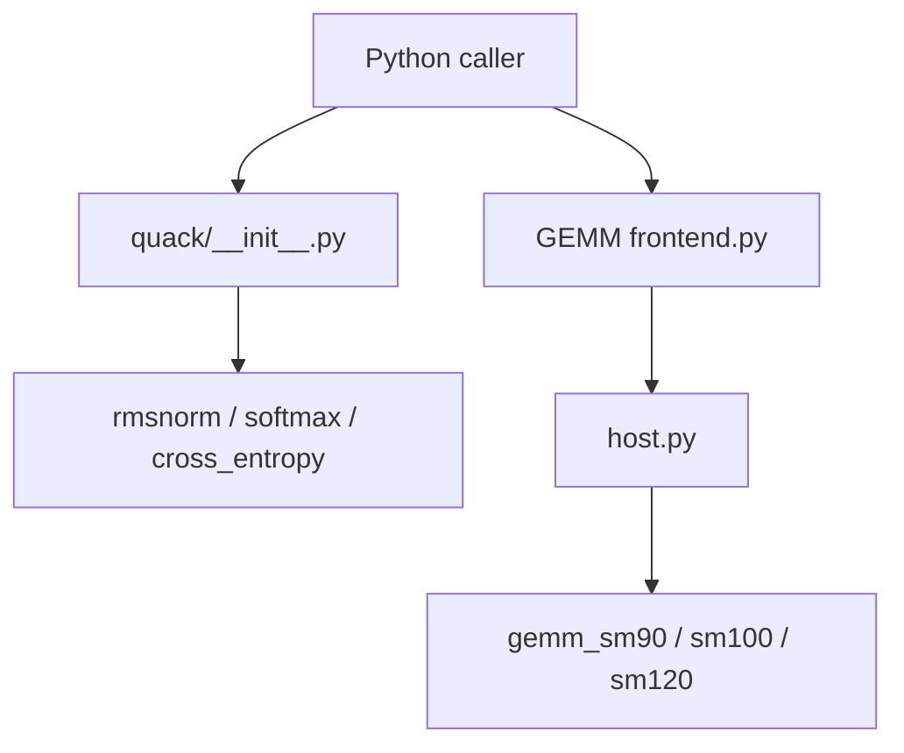

# Dao-AILab/quack

> Noyaux GPU en CuTe-DSL (normalisations, softmax, entropie croisée, GEMM) appelables depuis Python, pour qui optimise l'entraînement.

## Le problème
Les opérations mémoire-limitées et les GEMM avec épilogue demandent du CUDA bas niveau pour approcher la vitesse maximale du matériel.

## Ce que ça fait vraiment
- RMSNorm, Softmax, Cross entropy, LayerNorm : passes avant et arrière.
- GEMM avec épilogue pour Hopper, Blackwell et Blackwell GeForce.
- Le code décrit aussi un cache de noyaux compilés, des opérandes à blocs quantifiés, une transformée de Hadamard et un all-gather GEMM.
- Bindings JAX optionnels (softmax).

## Comment c'est branché


## Essayer
```bash
pip install quack-kernels
pip install 'quack-kernels[cu13]' --extra-index-url https://download.pytorch.org/whl/cu132
```
```python
from quack import rmsnorm, softmax, cross_entropy
```

## Coût et pièges
GPU H100, B200/B300 ou RTX 50, CUDA 12.9+, Python 3.12. Pour CUDA 13.x, ne pas utiliser uv (problème d'ordre d'installation, NVIDIA/cutlass#3259).

## Ce que ce n'est pas
Ni framework d'entraînement ni noyaux pour GPU anciens. La doc est mince : un blogpost et un exemple JAX.

## Alternatives
Aucune nommée dans le README.

## Pour toi
À surveiller : utile si tu as des GPU Hopper/Blackwell et écris des noyaux ; sinon sans intérêt immédiat.

