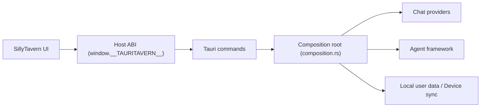

# Darkatse/TauriTavern

> Native SillyTavern client (Rust/Tauri v2) for desktop and mobile, with no Node.js to install.

## The problem
SillyTavern requires Node.js and a command line, and has no real mobile or desktop application.

## What it actually does
Reuses the SillyTavern frontend (synced with 1.18.0) and replaces the Node backend with a Rust backend (Cargo workspace, clean architecture). Compatible with character cards, chats, presets and frontend extensions (not Node plugins). Adds multi-device sync, an agent framework (tools, skills, sub-agents) and import from SillyTavern. The README is in Chinese.

## How it is wired


## Trying it
```bash
winget install --id TauriTavern.TauriTavern
brew install --cask tauritavern
curl -fsSL https://get.tauritavern.com/linux.sh | sh
```

## Cost and gotchas
Free; AI providers remain at your expense (keys). The iOS version goes through TestFlight, with its limits. AGPL-3.0.

## What it is not
Not the official SillyTavern client: an independent project. SillyTavern's Node plugins are not supported.

## Alternatives
- SillyTavern: the original, of which this is a port.

## For you
Ignore for your line of work: a role-playing app with an LLM, unrelated to data or MLOps.
