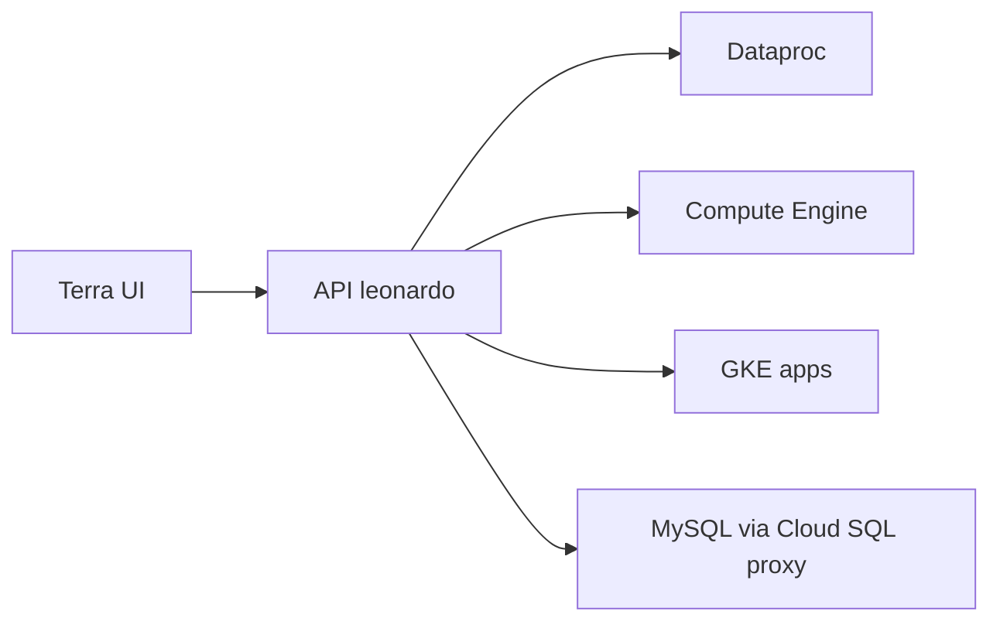

# DataBiosphere/leonardo

> Scala service that launches compute (Dataproc, VM, GKE) within Terra's security boundary, on Google Cloud.

## The problem
Researchers need to launch Jupyter, RStudio or Galaxy on protected data without managing the infrastructure.

## What it actually does
Exposes an API to launch Spark clusters (Dataproc), virtual machines (Compute Engine) and Kubernetes applications (GKE). It starts custom Docker images for Jupyter and RStudio, with Galaxy featured. A Java client is published, and normal usage goes through the Terra interface.

## How it is wired
Simplified diagram based on the sheet, no diagram provided.



## Trying it
```bash
git clone https://github.com/databiosphere/leonardo.git
git submodule update --init --recursive
brew bundle
./local/depends.sh -y
./local/proxies.sh start
sbt http/run
```

## Cost and gotchas
Runs on Google Cloud (billed). Running it locally requires VPN, Vault, Cloud SQL proxy, Java, sbt and Go. Tickets are tracked on JIRA, not on GitHub.

## What it is not
Not a standalone application: it only lives within the Terra ecosystem. No compatibility with any other cloud (GCP only).

## Alternatives
No alternative named in the README.

## For you
Ignore: internal Terra plumbing, impossible to reuse without the Broad infrastructure; useful only as a study of a notebook launcher.
