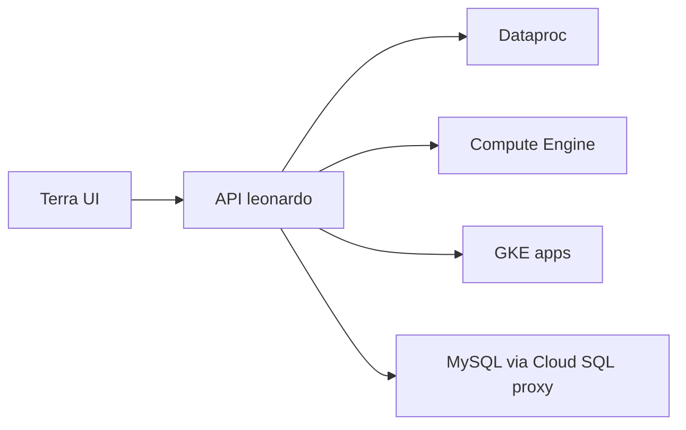

# DataBiosphere/leonardo

> Service Scala qui lance du calcul (Dataproc, VM, GKE) dans la frontière de sécurité de Terra, sur Google Cloud.

## Le problème
Les chercheurs ont besoin de lancer Jupyter, RStudio ou Galaxy sur des données protégées sans gérer l'infrastructure.

## Ce que ça fait vraiment
Expose une API pour lancer des clusters Spark (Dataproc), des machines virtuelles (Compute Engine) et des applications Kubernetes (GKE). Il démarre des images Docker personnalisées pour Jupyter et RStudio, avec Galaxy en vedette. Un client Java est publié, et l'usage normal passe par l'interface Terra.

## Comment c'est branché
Schéma simplifié d'après la fiche, sans diagramme fourni.



## Essayer
```bash
git clone https://github.com/databiosphere/leonardo.git
git submodule update --init --recursive
brew bundle
./local/depends.sh -y
./local/proxies.sh start
sbt http/run
```

## Coût et pièges
Tourne sur Google Cloud (facturé). Le lancement local exige VPN, Vault, Cloud SQL proxy, Java, sbt et Go. Le suivi des tickets se fait sur JIRA, pas sur GitHub.

## Ce que ce n'est pas
Pas une application autonome : elle ne vit que dans l'écosystème Terra. Aucune compatibilité avec un autre cloud (GCP uniquement).

## Alternatives
Aucune alternative nommée dans le README.

## Pour toi
À ignorer : plomberie interne de Terra, impossible à reprendre sans l'infrastructure Broad ; utile seulement comme étude d'un lanceur de notebooks.

