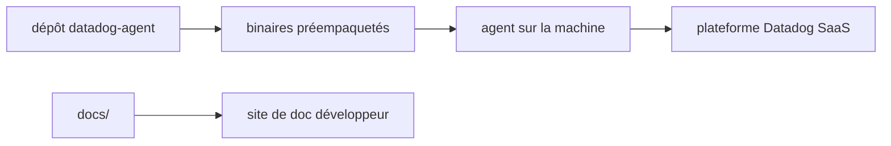

# DataDog/datadog-agent

> Source code of the Datadog agent versions 6 and 7, the collector installed on monitored machines.

## The problem
Sending metrics, traces and logs from a machine to an observability platform requires a collector.
Without it, nothing reaches Datadog.

## What it actually does
The README is very short: it announces the source code repository of the v6 and v7 agents and nothing more.
It points to the user documentation for the differences between v5, v6 and v7.
It mentions a list of prepackaged binaries for easy installation.
The developer documentation site, whose sources are under `docs/`, explains how to work on the agent.

## How it is wired

## Trying it
No command documented in the README: it points to the list of prepackaged binaries.

## Cost and gotchas
The agent is open, the platform is not: a paid Datadog account is needed to do anything with it.
All collected data goes to a third party.

## What it is not
Not a standalone observability platform: without a Datadog backend, the agent has nowhere to send data.
Not documented here: the README describes neither installation, configuration nor operation.
Not a generic collector like OpenTelemetry.

## Alternatives
No alternative named in the README.

## For you
Of no interest if you are not already a Datadog customer; insufficient material to judge otherwise.
