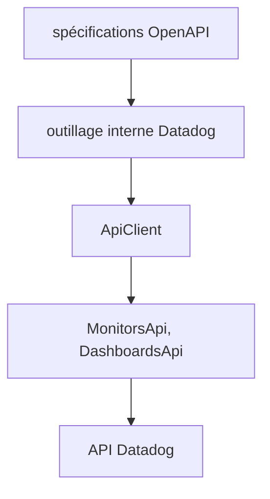

# DataDog/datadog-api-client-java

> Generated Java client to drive the Datadog API (monitors, dashboards) from a JVM application.

## The problem
Automating Datadog from Java code without writing the HTTP calls and data models by hand.

## What it actually does
The client is generated from Datadog's public OpenAPI specifications. It covers the v1 and v2 APIs (MonitorsApi, DashboardsApi...), with options for retries, compression, proxy, logging and unstable endpoints that must be enabled explicitly. Authentication uses an API key and an application key.

## How it is wired
Simplified diagram based on the sheet, no diagram provided.


## Trying it
```bash
mvn clean install
```
```java
ApiClient defaultClient = ApiClient.getDefaultApiClient();
MonitorsApi apiInstance = new MonitorsApi(defaultClient);
```

## Cost and gotchas
A paid Datadog account with API and application keys is required. Java 1.8+ and Maven or Gradle are required; one `ApiClient` per thread is recommended.

## What it is not
Not an observability tool: only an API client. The code is autogenerated, so contributions go through internal regeneration.

## Alternatives
No alternative named in the README.

## For you
Worth watching: useful only if you drive Datadog from the JVM; in Python MLOps, another client will be more natural.
