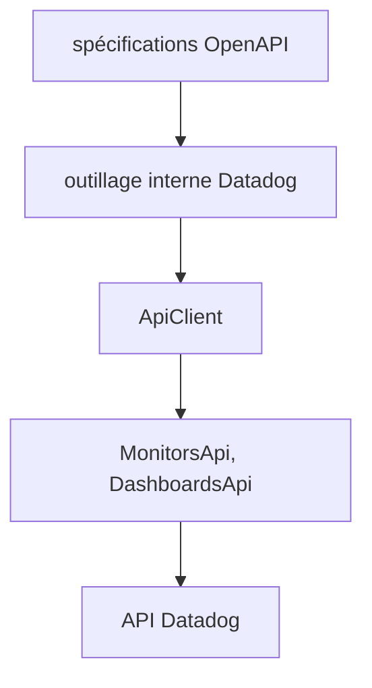

# DataDog/datadog-api-client-java

> Client Java généré pour piloter l'API Datadog (moniteurs, dashboards) depuis une application JVM.

## Le problème
Automatiser Datadog depuis du code Java sans écrire les appels HTTP et les modèles de données à la main.

## Ce que ça fait vraiment
Le client est généré depuis les spécifications OpenAPI publiques de Datadog. Il couvre l'API v1 et v2 (MonitorsApi, DashboardsApi…), avec options de nouvelle tentative, compression, proxy, journalisation et endpoints instables à activer explicitement. L'authentification passe par une clé d'API et une clé d'application.

## Comment c'est branché
Schéma simplifié d'après la fiche, sans diagramme fourni.


## Essayer
```bash
mvn clean install
```
```java
ApiClient defaultClient = ApiClient.getDefaultApiClient();
MonitorsApi apiInstance = new MonitorsApi(defaultClient);
```

## Coût et pièges
Il faut un compte Datadog payant avec clés d'API et d'application. Java 1.8+ et Maven ou Gradle sont requis ; un `ApiClient` par thread est recommandé.

## Ce que ce n'est pas
Pas un outil d'observabilité : seulement un client de l'API. Le code est autogénéré, donc les contributions passent par la régénération interne.

## Alternatives
Aucune alternative nommée dans le README.

## Pour toi
À surveiller : utile seulement si tu pilotes Datadog depuis la JVM ; en MLOps Python, un autre client sera plus naturel.

