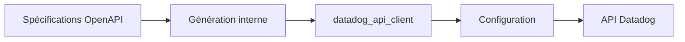

# DataDog/datadog-api-client-ruby

> Auto-generated Ruby client for the Datadog API, for scripting metrics, incidents, logs and configuration.

## The problem
Calling the Datadog API from Ruby without writing the requests and models by hand.

## What it actually does
Client generated from the OpenAPI specifications: classes per API (V1, V2), authentication via API and application keys, site selection (`datadoghq.eu`), pagination, retries on 429 and 5xx, proxy, compression, logging. Unstable endpoints require an explicit flag.

## How it is wired


## Trying it
```ruby
gem 'datadog_api_client'
require 'datadog_api_client'
api_instance = DatadogAPIClient::V1::IPRangesAPI.new
result = api_instance.get_ip_ranges
```

## Cost and gotchas
Ruby 2.6 minimum; Datadog account and API/application keys. Generated code: modifications may be regenerated.

## What it is not
Not a collection agent, only an API client.

## Alternatives
No alternative named in the README.

## For you
Ignore: Ruby client for a SaaS; if you drive Datadog from Python, take the equivalent client.
