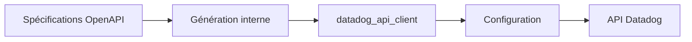

# DataDog/datadog-api-client-ruby

> Client Ruby autogénéré de l'API Datadog, pour scripter métriques, incidents, logs et configuration.

## Le problème
Appeler l'API Datadog depuis Ruby sans écrire les requêtes et les modèles à la main.

## Ce que ça fait vraiment
Client généré depuis les spécifications OpenAPI : classes par API (V1, V2), authentification par clés API et application, choix du site (`datadoghq.eu`), pagination, nouvelles tentatives sur 429 et 5xx, proxy, compression, journalisation. Les endpoints instables exigent un drapeau explicite.

## Comment c'est branché


## Essayer
```ruby
gem 'datadog_api_client'
require 'datadog_api_client'
api_instance = DatadogAPIClient::V1::IPRangesAPI.new
result = api_instance.get_ip_ranges
```

## Coût et pièges
Ruby 2.6 minimum ; compte Datadog et clés API/application. Code généré : les modifications peuvent être régénérées.

## Ce que ce n'est pas
Pas un agent de collecte, seulement un client d'API.

## Alternatives
Aucune alternative nommée dans le README.

## Pour toi
À ignorer : client Ruby d'un SaaS ; si tu pilotes Datadog depuis Python, prends le client équivalent.

