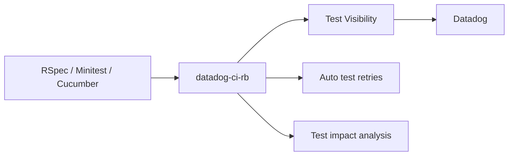

# DataDog/datadog-ci-rb

> Datadog's Ruby library that instruments RSpec, Minitest and Cucumber to send test results to Datadog.

## The problem
Flaky tests break builds and nobody sees their impact. You need metrics and automatic retries.

## What it actually does
It collects test results and sends them to Datadog: test visibility, automatic retry of failing tests, early detection of flaky tests, selection of the tests affected by a change. Annotations (`datadog_no_auto_retry`, `datadog_prevent_failure_suppression`) exclude specific tests from quarantine or retries.

## How it is wired
Simplified diagram based on the fiche, no diagram provided.



## Trying it
```ruby
it "checks a critical behavior", datadog_prevent_failure_suppression: true, datadog_no_auto_retry: true do
  expect(critical_behavior).to be_valid
end
```

## Cost and gotchas
The useful features depend on a Datadog account, a commercial service whose prices the README does not give. The instrumentation must be loaded before the tests are defined; setting a span tag by hand does not apply any exclusion.

## What it is not
It is not a test framework: it hooks into the existing ones. Without a Datadog backend, the point disappears. The README points to the official documentation for detailed configuration.

## Alternatives
No alternative named in the README.

## For you
Ignore: it is Ruby tied to a paid SaaS, far from a data / AI / MLOps profile, unless your team already uses Datadog for its Ruby tests.
