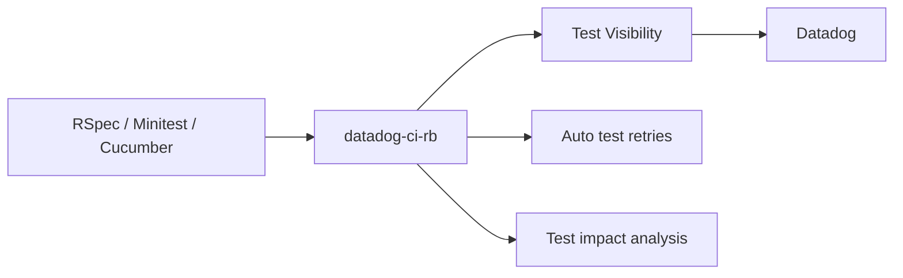

# DataDog/datadog-ci-rb

> Bibliothèque Ruby de Datadog qui instrumente RSpec, Minitest et Cucumber pour envoyer les résultats de tests à Datadog.

## Le problème
Les tests instables (flaky) cassent les builds et personne ne voit leur impact. Il faut des métriques et des relances automatiques.

## Ce que ça fait vraiment
Elle collecte les résultats de tests et les envoie à Datadog : visibilité des tests, relance automatique des tests en échec, détection précoce des tests instables, sélection des tests touchés par un changement. Des annotations (`datadog_no_auto_retry`, `datadog_prevent_failure_suppression`) excluent des tests précis de la quarantaine ou des relances.

## Comment c'est branché
Schéma simplifié d'après la fiche, sans diagramme fourni.



## Essayer
```ruby
it "checks a critical behavior", datadog_prevent_failure_suppression: true, datadog_no_auto_retry: true do
  expect(critical_behavior).to be_valid
end
```

## Coût et pièges
Les fonctions utiles reposent sur un compte Datadog, service commercial dont le README ne donne pas les tarifs. Il faut charger l'instrumentation avant de définir les tests ; poser un tag de span à la main n'applique aucune exclusion.

## Ce que ce n'est pas
Ce n'est pas un framework de test : il se greffe sur ceux qui existent. Sans backend Datadog, l'intérêt tombe. Le README renvoie la configuration détaillée à la documentation officielle.

## Alternatives
Aucune alternative nommée dans le README.

## Pour toi
À ignorer : c'est du Ruby lié à un SaaS payant, loin d'un profil data / IA / MLOps, sauf si ton équipe utilise déjà Datadog pour ses tests Ruby.

