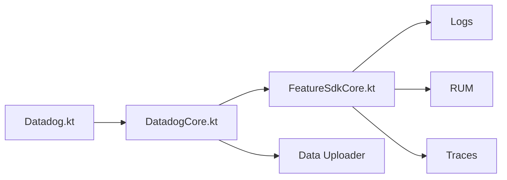

# DataDog/dd-sdk-android

> Client SDK for sending logs, traces and RUM data from Android and Android TV applications to Datadog.

## The problem
Observing an Android app's behavior in production: errors, requests, sessions.

## What it actually does
A core registers the features, shares a context, persists data with consent handling and uploads it. The README documents logs, RUM and traces; the tree also shows Session Replay, profiling, NDK crash reporting and feature flags. Integrations: Timber, Coil, Fresco, Glide, Compose, SQLDelight, RxJava, Retrofit, Apollo, Kotlin coroutines.

## How it is wired


## Trying it
```kotlin
val retrofitClient = Retrofit.Builder()
        .client(okHttpClient)
        .build()
```
(with an `OkHttpClient` instrumented by the SDK).

## Cost and gotchas
A Datadog account is required; billing depends on your plan.

## What it is not
Not a standalone tool: it is only valuable with a Datadog account receiving the data. Not an SDK for platforms other than Android.

## Alternatives
No alternative named in the README.

## For you
Ignore: a mobile SDK tied to a SaaS, outside data/AI/MLOps.
