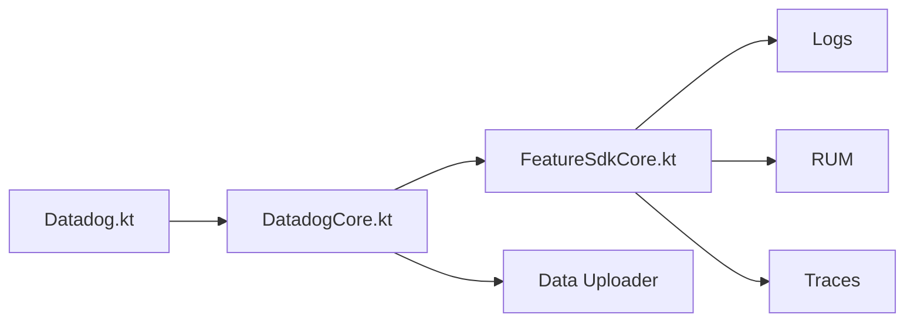

# DataDog/dd-sdk-android

> SDK client pour envoyer logs, traces et données RUM d'applications Android et Android TV à Datadog.

## Le problème
Observer en production le comportement d'une appli Android : erreurs, requêtes, sessions.

## Ce que ça fait vraiment
Un noyau enregistre les fonctions, partage un contexte, persiste avec prise en compte du consentement et envoie les données. Le README documente logs, RUM, traces ; l'arbre montre aussi Session Replay, profiling, crash NDK et feature flags. Intégrations Timber, Coil, Fresco, Glide, Compose, SQLDelight, RxJava, Retrofit, Apollo, coroutines Kotlin.

## Comment c'est branché


## Essayer
```kotlin
val retrofitClient = Retrofit.Builder()
        .client(okHttpClient)
        .build()
```
(avec un `OkHttpClient` instrumenté par le SDK).

## Coût et pièges
Compte Datadog requis ; facture selon ton offre.

## Ce que ce n'est pas
Pas utilisable sans backend Datadog.

## Alternatives
Aucune alternative nommée dans le README.

## Pour toi
À ignorer : SDK mobile lié à un SaaS, hors data/IA/MLOps.

