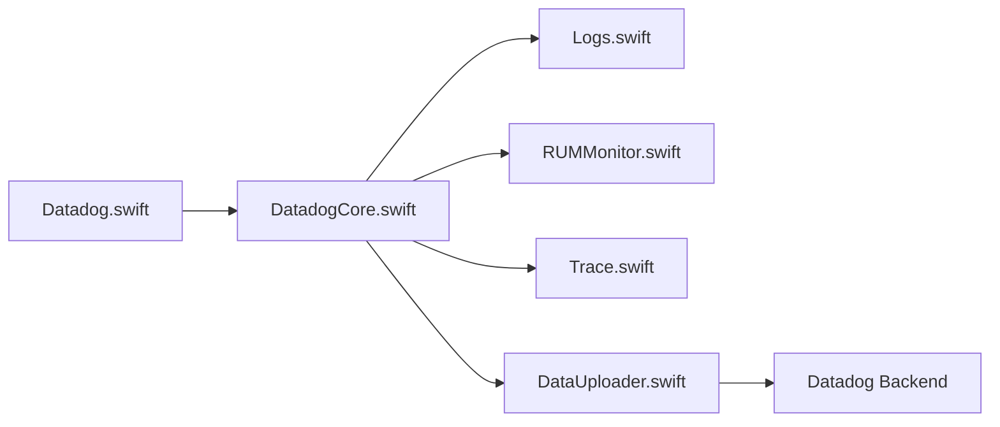

# DataDog/dd-sdk-ios

> Swift/Objective-C SDK that sends logs, traces and RUM events from iOS/tvOS apps to Datadog.

## The problem
Seeing what happens in a mobile app in production: logs, network latency, user sessions.

## What it actually does
Initializes a common core, enables features (logs, RUM, traces, WebView tracking), captures events manually or through automatic URLSession instrumentation, then stores them and sends them to Datadog. The graph also mentions Session Replay and profiling. Integrations with Alamofire, Apollo, SDWebImage, OpenAPI Generator.

## How it is wired

## Trying it
No command in the README: it points to the Datadog documentation.

## Cost and gotchas
A Datadog account is required; billing depends on your Datadog plan.

## What it is not
Not a standalone tool: without a Datadog backend, it is useless.

## Alternatives
No alternative named in the README.

## For you
Ignore: a mobile SDK tied to a SaaS, outside your data/AI scope, unless you instrument an iOS app.
