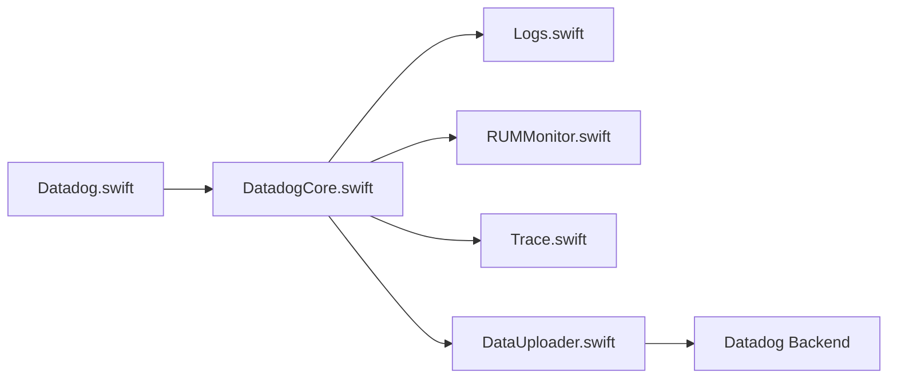

# DataDog/dd-sdk-ios

> SDK Swift/Objective-C pour envoyer logs, traces et événements RUM d'applications iOS/tvOS vers Datadog.

## Le problème
Voir ce qui se passe dans une appli mobile en production : logs, latence réseau, sessions utilisateur.

## Ce que ça fait vraiment
Initialise un noyau commun, active des fonctions (logs, RUM, traces, suivi de WebView), capte les événements manuellement ou par instrumentation automatique d'URLSession, puis les stocke et les envoie à Datadog. Le graphe cite aussi Session Replay et profiling. Intégrations Alamofire, Apollo, SDWebImage, OpenAPI Generator.

## Comment c'est branché

## Essayer
Aucune commande dans le README : il renvoie à la documentation Datadog.

## Coût et pièges
Compte Datadog requis ; la facturation dépend de ton offre Datadog.

## Ce que ce n'est pas
Pas un outil autonome : sans backend Datadog, il ne sert à rien.

## Alternatives
Aucune alternative nommée dans le README.

## Pour toi
À ignorer : SDK mobile lié à un SaaS, hors de ton périmètre data/IA, sauf si tu instrumentes une appli iOS.

