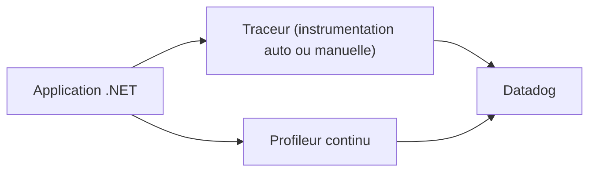

# DataDog/dd-trace-dotnet

> Datadog's .NET libraries for tracing and profiling .NET applications.

## The problem
Observing the performance of .NET applications in production.

## What it actually does
.NET tracer that automatically instruments supported libraries and allows manual instrumentation; continuous profiler. Feeds distributed tracing, application security, CI visibility and dynamic instrumentation. NuGet packages `Datadog.Trace` and `Datadog.Trace.OpenTracing`, Windows and Linux installers.

## How it is wired
Simplified diagram based on the sheet, no diagram provided.

## Trying it
No command documented in the README: see the Datadog configuration documents.

## Cost and gotchas
The client is free but mostly useful with a paid Datadog account. 353 open issues.

## What it is not
Not a complete monitoring tool on its own: it produces traces and profiles sent to Datadog. Not meant for languages other than .NET.

## Alternatives
No alternative named in the README.

## For you
Ignore unless your team uses Datadog and .NET: profile outside data/AI.
