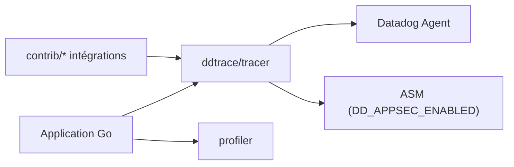

# DataDog/dd-trace-go

> Datadog's Go libraries for APM, continuous profiling and application security.

## The problem
Seeing where a Go application loses time or comes under attack requires integrated tracing, profiling and detection.

## What it actually does
The `ddtrace/tracer` package traces Go code, `contrib` instruments common libraries (net/http, gorilla/mux, database/sql) as nested modules, `profiler` sends CPU/memory profiles to Datadog. ASM is enabled with `DD_APPSEC_ENABLED=true` and goes through the tracer. A migration document covers the old 1.60.x versions.

## How it is wired


## Trying it
```bash
go get github.com/DataDog/dd-trace-go/v2/ddtrace/tracer
go get github.com/DataDog/dd-trace-go/v2/profiler
go get github.com/DataDog/dd-trace-go/contrib/gorilla/mux/v2
```

## Cost and gotchas
Data is sent to Datadog: an account and subscription are required to make use of it. Integration tests run through Docker and docker-compose. License not identified by GitHub.

## What it is not
Not a standalone open source tool: the tracer is the client half of a commercial service.

## Alternatives
None named in the README.

## For you
Ignore unless you are already a Datadog customer with Go services; for ML telemetry, an open standard like OpenTelemetry is more neutral.
