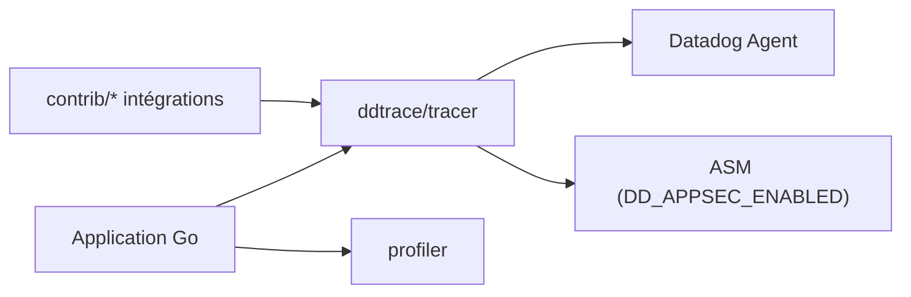

# DataDog/dd-trace-go

> Bibliothèques Go de Datadog pour l'APM, le profilage continu et la sécurité applicative.

## Le problème
Voir où une application Go perd du temps ou subit des attaques demande du traçage, du profilage et de la détection intégrés.

## Ce que ça fait vraiment
Le paquet `ddtrace/tracer` trace le code Go, `contrib` instrumente des bibliothèques courantes (net/http, gorilla/mux, database/sql) en modules imbriqués, `profiler` envoie des profils CPU/mémoire à Datadog. L'ASM s'active avec `DD_APPSEC_ENABLED=true` et passe par le traceur. Un document de migration couvre les anciennes versions 1.60.x.

## Comment c'est branché


## Essayer
```bash
go get github.com/DataDog/dd-trace-go/v2/ddtrace/tracer
go get github.com/DataDog/dd-trace-go/v2/profiler
go get github.com/DataDog/dd-trace-go/contrib/gorilla/mux/v2
```

## Coût et pièges
Les données partent vers Datadog : compte et abonnement requis pour l'exploiter. Tests d'intégration via Docker et docker-compose. Licence non identifiée par GitHub.

## Ce que ce n'est pas
Pas un outil open source autonome : le traceur est la moitié client d'un service commercial.

## Alternatives
Aucune nommée dans le README.

## Pour toi
À ignorer sauf si tu es déjà client Datadog avec des services Go ; pour la télémétrie ML, un standard ouvert comme OpenTelemetry est plus neutre.

