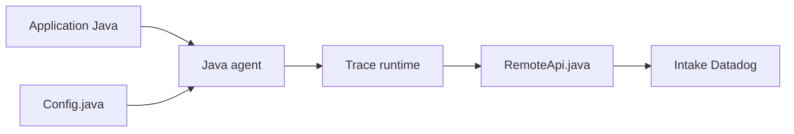

# DataDog/dd-trace-java

> Datadog's Java agent for tracing and profiling Java applications.

## The problem
Observing the performance and errors of distributed Java applications.

## What it actually does
Automatic instrumentation (agent) and manual API, context propagation, sending traces to Datadog, continuous profiling, CI visibility, application security, dependency telemetry, LLM observability, tracer flare. A minor version is released every month.

## How it is wired

## Trying it
No command documented in the README: it points to the Datadog configuration documentation.

## Cost and gotchas
The client is free, but the value goes through a paid Datadog account. 513 open issues.

## What it is not
Not a standalone tool: without a Datadog backend, the traces have no described destination.

## Alternatives
No alternative named in the README.

## For you
Ignore unless your company already uses Datadog: otherwise prefer neutral OpenTelemetry instrumentation.
