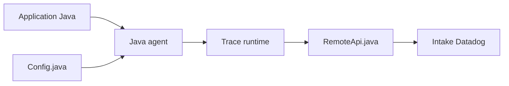

# DataDog/dd-trace-java

> Agent Java de Datadog pour tracer et profiler des applications Java.

## Le problème
Observer les performances et erreurs d'applications Java distribuées.

## Ce que ça fait vraiment
Instrumentation automatique (agent) et API manuelle, propagation de contexte, envoi de traces vers Datadog, profilage continu, visibilité CI, sécurité applicative, télémétrie de dépendances, observabilité LLM, tracer flare. Version mineure publiée chaque mois.

## Comment c'est branché

## Essayer
Aucune commande documentée dans le README : renvoie à la documentation de configuration Datadog.

## Coût et pièges
Le client est libre, mais la valeur passe par un compte Datadog payant. 513 issues ouvertes.

## Ce que ce n'est pas
Pas un outil autonome : sans backend Datadog, les traces n'ont pas de destination décrite.

## Alternatives
Aucune alternative nommée dans le README.

## Pour toi
À ignorer sauf si ton entreprise utilise déjà Datadog : sinon préfère une instrumentation OpenTelemetry neutre.

