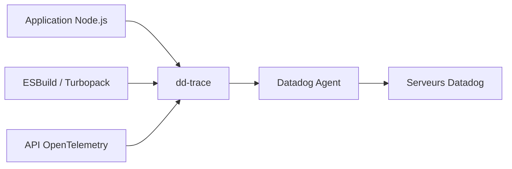

# DataDog/dd-trace-js

> `dd-trace` APM tracer for Node.js applications, which sends traces to a Datadog agent.

## The problem
You need to capture performance traces from a Node.js application and send them to Datadog.

## What it actually does
npm package `dd-trace`: captures APM data and sends it to an agent that aggregates it and forwards it to Datadog's servers. Version lines: v6 current (Node >= 22), v5 in maintenance, v1 to v4 end of life. ESBuild plugin and Turbopack wrapper for Next.js 15.5+. A separate project handles Lambda. Support for the OpenTelemetry API.

## How it is wired


## Trying it
```bash
npm install dd-trace
npm install dd-trace@5
```

## Cost and gotchas
A Datadog account is needed to use the data. Do not use the Turbopack wrapper for client or edge bundles. License not identified by GitHub.

## What it is not
No local storage or interface: everything depends on the Datadog service.

## Alternatives
- datadog-lambda-js: for Lambda cases (cited).

## For you
Ignore unless you have a Node.js service already on Datadog: off-topic for a data/AI/MLOps profile, and locked into a SaaS.
