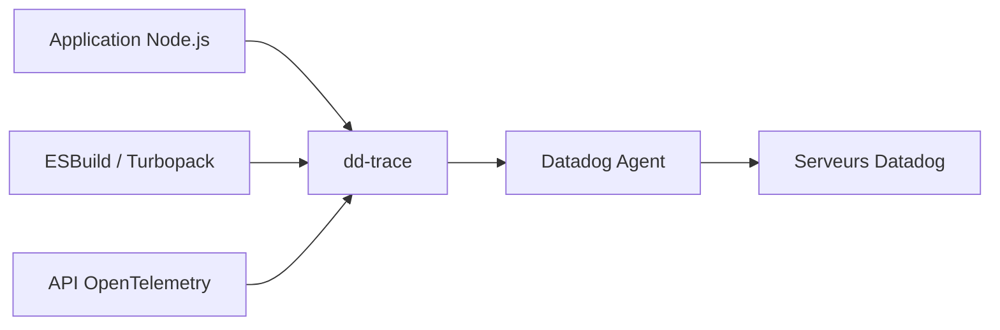

# DataDog/dd-trace-js

> Traceur APM `dd-trace` pour applications Node.js, qui envoie les traces à un agent Datadog.

## Le problème
Il faut capturer des traces de performance d'une application Node.js et les envoyer à Datadog.

## Ce que ça fait vraiment
Paquet npm `dd-trace` : capture les données APM, les envoie à un agent qui les agrège puis les transmet aux serveurs Datadog. Lignes de version : v6 courante (Node ≥ 22), v5 en maintenance, v1 à v4 en fin de vie. Plugin ESBuild et wrapper Turbopack pour Next.js 15.5+. Un projet séparé gère Lambda. Support de l'API OpenTelemetry.

## Comment c'est branché


## Essayer
```bash
npm install dd-trace
npm install dd-trace@5
```

## Coût et pièges
Compte Datadog nécessaire pour exploiter les données. Ne pas utiliser le wrapper Turbopack pour les bundles client ou edge. Licence non identifiée par GitHub.

## Ce que ce n'est pas
Pas de stockage ni d'interface locale : tout dépend du service Datadog.

## Alternatives
- datadog-lambda-js : pour les cas Lambda (cité).

## Pour toi
À ignorer sauf service Node.js déjà sur Datadog : hors sujet pour un profil data/IA/MLOps, et verrouillé sur un SaaS.

