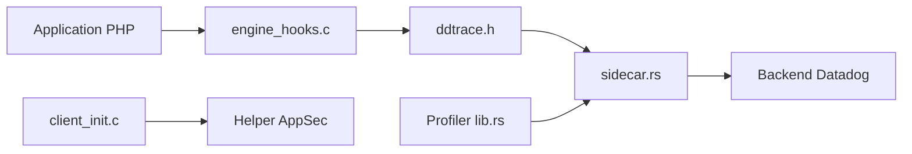

# DataDog/dd-trace-php

> Datadog PHP extension for APM and distributed tracing.

## The problem
Observing the requests and errors of PHP applications.

## What it actually does
Native extension instrumenting the PHP engine, user API, framework integrations, OpenTracing-compatible tracer. Profiler, application security (extension, helper process, WAF), telemetry, remote configuration, sidecar. Installation through PECL (`datadog_trace`) or from source.

## How it is wired

## Trying it
No command documented in the README: it points to the installation documentation.

## Cost and gotchas
Compilation (cargo 1.91.1 minimum) and a paid Datadog account to use the data.

## What it is not
Not a standalone tool nor vendor-independent.

## Alternatives
No alternative named in the README.

## For you
Ignore: proprietary PHP tracing, outside your data/AI stack.
