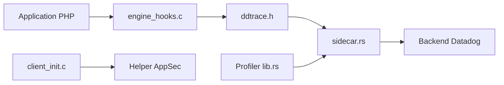

# DataDog/dd-trace-php

> Extension PHP de Datadog pour l'APM et le traçage distribué.

## Le problème
Observer les requêtes et erreurs d'applications PHP.

## Ce que ça fait vraiment
Extension native instrumentant le moteur PHP, API utilisateur, intégrations de frameworks, traceur compatible OpenTracing. Profileur, sécurité applicative (extension, processus auxiliaire, WAF), télémétrie, configuration distante, sidecar. Installation par PECL (`datadog_trace`) ou sources.

## Comment c'est branché

## Essayer
Aucune commande documentée dans le README : renvoie à la documentation d'installation.

## Coût et pièges
Compilation (cargo 1.91.1 minimum) et compte Datadog payant pour exploiter les données.

## Ce que ce n'est pas
Pas un outil autonome ni indépendant du fournisseur.

## Alternatives
Aucune alternative nommée dans le README.

## Pour toi
À ignorer : traçage PHP propriétaire, hors de ta pile data/IA.

