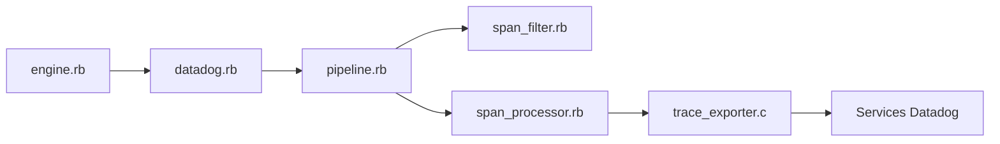

# DataDog/dd-trace-rb

> Datadog's Ruby gem for tracing, profiling and securing Ruby applications.

## The problem
Identify bottlenecks and problems in Ruby applications.

## What it actually does
Instrumentation and trace pipeline (filter, span processor, native export), native profiling, application security (engine, API security, AI Guard), dynamic instrumentation, feature flag evaluation, telemetry. The gem's provenance is verifiable. Upgrade from 1.x is documented.

## How it is wired

## Trying it
No command documented in the README: it points to Datadog's public documentation.

## Cost and gotchas
A paid Datadog account is needed to use the data; license not identified by GitHub.

## What it is not
Not a standalone tool, nor vendor-independent.

## Alternatives
No alternative named in the README.

## For you
Ignore unless you use Ruby under Datadog: outside your data/AI stack.
