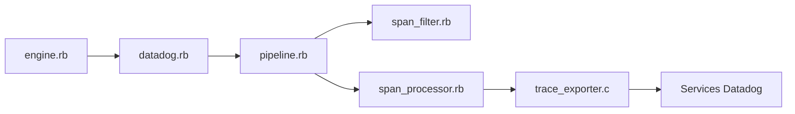

# DataDog/dd-trace-rb

> Gem Ruby de Datadog pour tracer, profiler et sécuriser des applications Ruby.

## Le problème
Identifier les goulots d'étranglement et problèmes d'applications Ruby.

## Ce que ça fait vraiment
Instrumentation et pipeline de traces (filtre, processeur de spans, export natif), profilage natif, sécurité applicative (moteur, sécurité d'API, AI Guard), instrumentation dynamique, évaluation de feature flags, télémétrie. La provenance du gem est vérifiable. Mise à niveau depuis la 1.x documentée.

## Comment c'est branché

## Essayer
Aucune commande documentée dans le README : renvoie à la documentation publique de Datadog.

## Coût et pièges
Compte Datadog payant pour exploiter les données ; licence non identifiée par GitHub.

## Ce que ce n'est pas
Pas un outil autonome ni indépendant du fournisseur.

## Alternatives
Aucune alternative nommée dans le README.

## Pour toi
À ignorer sauf Ruby sous Datadog : hors de ta pile data/IA.

