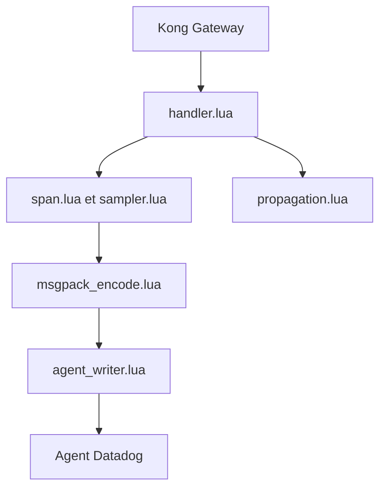

# DataDog/kong-plugin-ddtrace

> Kong Gateway plugin that sends request traces to Datadog APM, for API teams.

## The problem
Without gateway-level tracing, API slowdowns seen by Kong stay invisible in Datadog.

## What it actually does
Captures the traces of requests passing through Kong and forwards them to the Datadog agent. The code separates handler, schema, spans, sampling, propagation (Datadog and W3C), MessagePack encoding and sending to the agent. Configured when registering the plugin or through environment variables. Internal relationships are not verified.

## How it is wired


## Trying it
```bash
luarocks install kong-plugin-ddtrace
curl -i -X POST --url http://${KONG_ADMIN_HOST}:${KONG_ADMIN_PORT}/plugins/ --data 'name=ddtrace'
```

## Cost and gotchas
Kong Gateway >= v3.4 (3.4.3.5), Datadog agent and Datadog API key. Older Kong versions require plugin v0.2.2 or earlier.

## What it is not
Not a standalone observability tool: without Datadog, it is useless. It only traces what goes through Kong.

## Alternatives
None named in the README.

## For you
Ignore: useful only if you run Kong and Datadog, outside the data / AI core.
