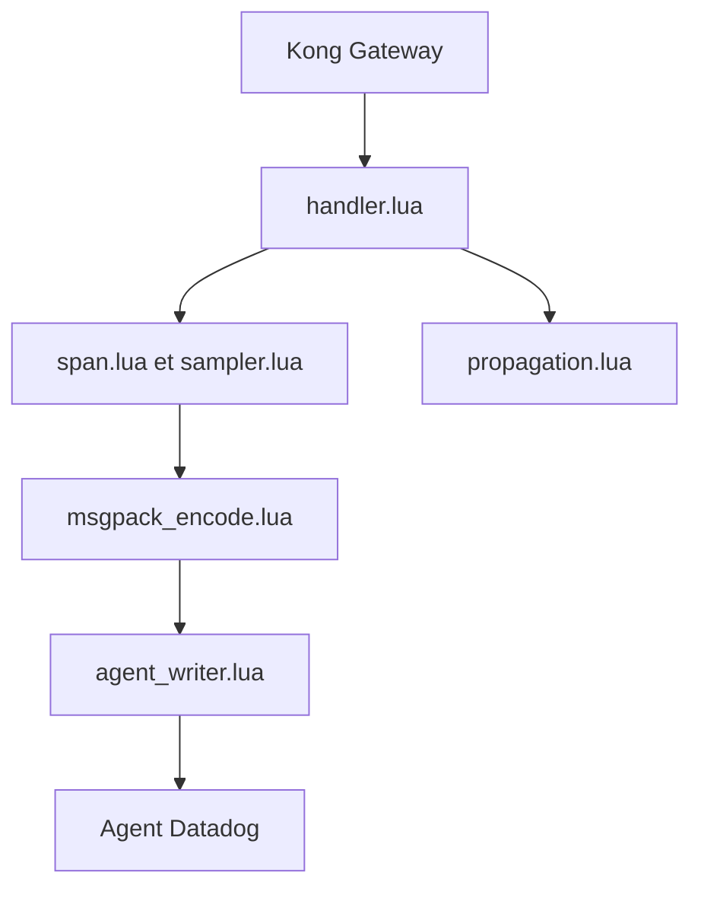

# DataDog/kong-plugin-ddtrace

> Plugin Kong Gateway qui envoie les traces des requêtes à l'APM Datadog, pour équipes API.

## Le problème
Sans traçage au niveau de la passerelle, les lenteurs d'API vues par Kong restent invisibles dans Datadog.

## Ce que ça fait vraiment
Capture les traces des requêtes passant par Kong et les transmet à l'agent Datadog. Le code sépare handler, schéma, spans, échantillonnage, propagation (Datadog et W3C), encodage MessagePack et envoi vers l'agent. Configuration à l'enregistrement du plugin ou par variables d'environnement. Les relations internes ne sont pas vérifiées.

## Comment c'est branché


## Essayer
```bash
luarocks install kong-plugin-ddtrace
curl -i -X POST --url http://${KONG_ADMIN_HOST}:${KONG_ADMIN_PORT}/plugins/ --data 'name=ddtrace'
```

## Coût et pièges
Kong Gateway >= v3.4 (3.4.3.5), agent Datadog et clé d'API Datadog. Les anciennes versions de Kong demandent le plugin v0.2.2 ou antérieur.

## Ce que ce n'est pas
Pas un outil d'observabilité autonome : sans Datadog, il ne sert à rien. Il ne trace que ce qui passe par Kong.

## Alternatives
Aucune nommée dans le README.

## Pour toi
Ignorer : utile seulement si tu exploites Kong et Datadog, hors du cœur data / IA.

