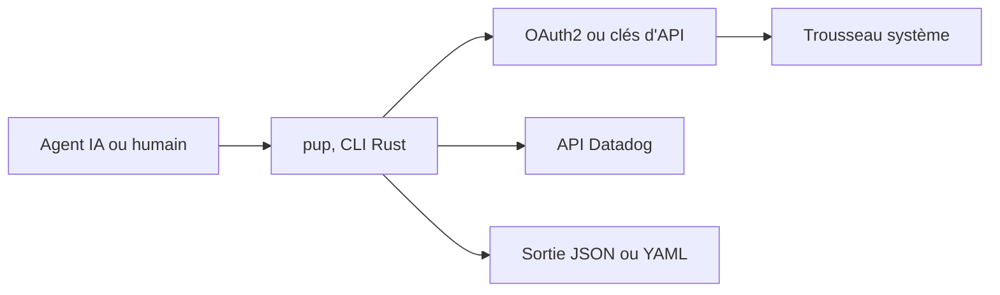

# DataDog/pup

> Datadog command line designed for AI agents: metrics, logs, monitors, incidents and security.

## The problem
An agent that needs to read Datadog runs into a vast API, long-lived keys and outputs that are hard to parse.

## What it actually does
Same README as datadog-labs/pup, with the DataDog/pup spelling (a catalogue duplicate, same statistics and same dates). A Rust binary covering the Datadog APIs (metrics, logs, traces, monitors, SLOs, incidents, security), with JSON or YAML output and OAuth2 login with PKCE.

## How it is wired
Simplified diagram based on the sheet, no diagram provided.



## Trying it
```bash
curl -fsSL https://raw.githubusercontent.com/DataDog/pup/main/install.sh | sh
pup auth login
pup monitors list --tags="team:api-platform"
pup metrics query --query="avg:system.cpu.user{*}"
```

## Cost and gotchas
A paid Datadog account is required; OAuth2 needs dynamic client registration enabled on your site, otherwise it falls back to `DD_API_KEY` and `DD_APP_KEY`. Node.js 22 or later for `pup setup`.

## What it is not
Not a tool independent of Datadog, nor an open source replacement. It is not a second project: the entry is a duplicate of the datadog-labs/pup repository.

## Alternatives
The Datadog MCP server, mentioned for profiling.

## For you
Worth watching like datadog-labs/pup: keep only one of the two entries, since the sheet is identical.
