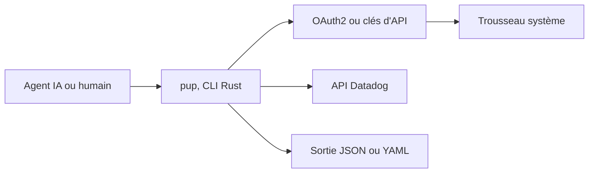

# DataDog/pup

> Ligne de commande Datadog conçue pour les agents IA : métriques, logs, monitors, incidents et sécurité.

## Le problème
Un agent qui doit lire Datadog se heurte à une API vaste, à des clés longue durée et à des sorties difficiles à parser.

## Ce que ça fait vraiment
Même README que datadog-labs/pup, avec la graphie DataDog/pup (doublon du catalogue, mêmes statistiques et mêmes dates). Binaire Rust couvrant les API Datadog (métriques, logs, traces, monitors, SLO, incidents, sécurité), avec sortie JSON ou YAML et connexion OAuth2 avec PKCE.

## Comment c'est branché
Schéma simplifié d'après la fiche, sans diagramme fourni.



## Essayer
```bash
curl -fsSL https://raw.githubusercontent.com/DataDog/pup/main/install.sh | sh
pup auth login
pup monitors list --tags="team:api-platform"
pup metrics query --query="avg:system.cpu.user{*}"
```

## Coût et pièges
Compte Datadog payant requis ; OAuth2 demande l'enregistrement dynamique de client activé sur ton site, sinon repli sur `DD_API_KEY` et `DD_APP_KEY`. Node.js 22 ou plus pour `pup setup`.

## Ce que ce n'est pas
Pas un outil indépendant de Datadog ni un remplaçant open source. Ce n'est pas un second projet : l'entrée est un doublon du dépôt datadog-labs/pup.

## Alternatives
Le serveur MCP de Datadog, cité pour le profiling.

## Pour toi
À surveiller comme datadog-labs/pup : retiens une seule des deux entrées, la fiche étant identique.

