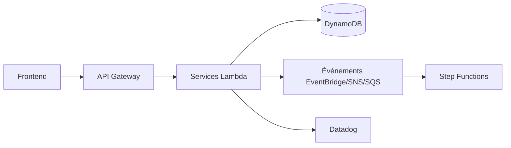

# DataDog/serverless-sample-app

> Multi-language AWS serverless demo application showing Datadog observability, for cloud engineers.

## The problem
Tracing an event-driven serverless system (queues, workflows, Lambda) end to end is hard without a realistic example.

## What it actually does
A shop demo: product, inventory, order (Step Functions), user (JWT), loyalty, pricing and activity services. Each one comes in Node, Python, .NET, Java, Go or Rust, with CDK, SAM, Terraform or SST as the case may be. It illustrates trace propagation, Span Links, OpenTelemetry semantic conventions and Data Streams Monitoring. An Artillery load test is included.

## How it is wired


## Trying it
```bash
./cdk-deploy-all.sh
cd src/frontend && npm i && node generateConfig.mjs
npm run start
cd loadtest && npm i && artillery run loadtest.yml
```
Deployment runs inside the provided Docker image.

## Cost and gotchas
AWS resources and a Datadog account are billable (`DD_API_KEY` key), as the README warns. Remove with `./cdk-destroy.sh`. The demo admin credentials are public.

## What it is not
Not a production template: it is a showcase of the Datadog solution, and coverage varies by language.

## Alternatives
None cited in the README.

## For you
Watch: good material to learn tracing of event-driven architectures, but it shows no ML and assumes a Datadog subscription.
