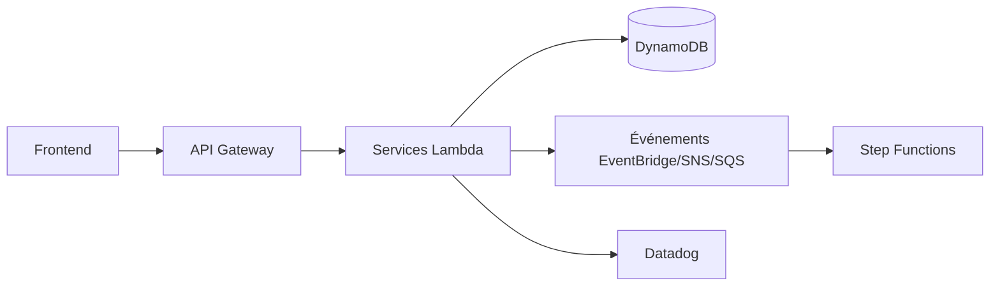

# DataDog/serverless-sample-app

> Application démo serverless AWS multi-langages montrant l'observabilité Datadog, pour ingénieurs cloud.

## Le problème
Tracer de bout en bout un système événementiel serverless (files, workflows, Lambda) est difficile sans exemple réaliste.

## Ce que ça fait vraiment
Démo de boutique : services produits, inventaire, commandes (Step Functions), utilisateurs (JWT), fidélité, prix, activité. Chacun est en Node, Python, .NET, Java, Go ou Rust, avec CDK, SAM, Terraform ou SST selon le cas. Elle illustre propagation de traces, Span Links, conventions sémantiques OpenTelemetry et Data Streams Monitoring. Un test de charge Artillery est inclus.

## Comment c'est branché


## Essayer
```bash
./cdk-deploy-all.sh
cd src/frontend && npm i && node generateConfig.mjs
npm run start
cd loadtest && npm i && artillery run loadtest.yml
```
Le déploiement se lance dans l'image Docker fournie.

## Coût et pièges
Ressources AWS et compte Datadog facturables (clé `DD_API_KEY`), le README avertit. Supprimer avec `./cdk-destroy.sh`. Les identifiants admin de démo sont publics.

## Ce que ce n'est pas
Pas un modèle de production : c'est une vitrine de la solution Datadog, la couverture varie selon le langage.

## Alternatives
Aucune citée dans le README.

## Pour toi
Surveiller : bon matériau pour apprendre le traçage d'architectures événementielles, mais il ne montre pas de ML et suppose un abonnement Datadog.

